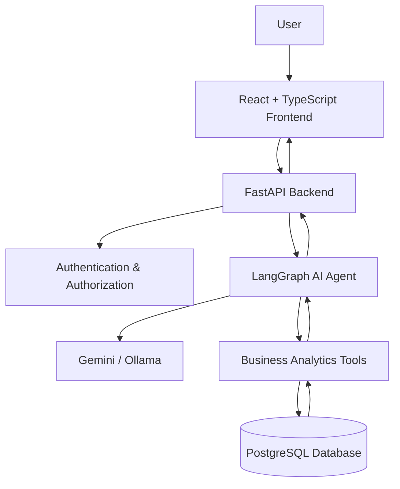

# 🚀 BusinessPilot AI
### Enterprise AI Business Assistant

<p align="center">
  <strong>Turn business data into actionable insights through natural language.</strong>
</p>

<p align="center">
  <a href="https://businesspilotai.onrender.com">
    
  </a>
  <a href="https://github.com/MJcoder20/BusinessPilotAI">
    
  </a>
</p>

<p align="center">
  
  
  
  
  
  
</p>

---

## 📌 Overview

**BusinessPilot AI** is a full-stack AI-powered business assistant that enables users to interact with business information using natural language.

Instead of manually navigating dashboards and reports, users can ask questions about their business operations and receive AI-generated answers based on structured CRM and ERP data.

The application combines conversational AI, business analytics, database integration, and secure user management in a production-deployed application.

## ✨ Key Features

| Feature | Description |
|---|---|
| 🤖 AI Business Assistant | Ask business questions using natural language. |
| 📊 Business Analytics | Retrieve relevant business metrics and insights. |
| ⚡ Streaming Responses | Receive AI responses token by token. |
| 💬 Conversation History | Create, retrieve, and manage persistent conversations. |
| 🔐 Authentication | Secure registration, login, and session management. |
| 👥 Role-Based Access | Different permissions for admins, managers, and employees. |
| 🗄️ Database Integration | Persistent business data using PostgreSQL. |
| 🐳 Docker Support | Containerized application infrastructure. |

## 🧠 AI Capabilities

BusinessPilot AI uses a LangGraph-powered agent with specialized business tools.

| AI Tool | Purpose |
|---|---|
| `get_business_dashboard` | Retrieve an overview of business performance. |
| `get_top_customers` | Identify top customers. |
| `get_low_stock_products` | Find products with low inventory. |
| `get_overdue_invoices` | Identify overdue invoices. |
| `get_daily_revenue` | Retrieve daily revenue information. |

The agent uses these tools to answer questions using business database information rather than relying solely on general language-model knowledge.

## 🏗️ System Architecture



## 🛠️ Technology Stack

### Frontend
- React
- TypeScript
- Vite
- Axios

### Backend
- Python
- FastAPI
- SQLAlchemy
- Alembic

### Artificial Intelligence
- LangChain
- LangGraph
- Google Gemini
- Ollama

### Database & Security
- PostgreSQL
- JWT authentication
- Argon2 password hashing
- Refresh-token rotation
- Role-based access control

### Infrastructure & Deployment
- Docker
- Docker Compose
- Render
- Neon PostgreSQL
- GitHub Actions

## 📂 Project Structure

```text
BusinessPilotAI/
│
├── backend/
│   ├── app/
│   │   ├── api/
│   │   ├── core/
│   │   ├── models/
│   │   ├── schemas/
│   │   ├── services/
│   │   └── ...
│   ├── scripts/
│   └── tests/
│
├── frontend/
│   ├── src/
│   │   ├── components/
│   │   ├── context/
│   │   ├── services/
│   │   └── ...
│   └── package.json
│
├── docs/
├── infrastructure/
├── .github/
├── docker-compose.yml
└── README.md
```

## 🚀 Live Application

<p align="center">
  <a href="https://businesspilotai.onrender.com">
    <strong>👉 Open BusinessPilot AI</strong>
  </a>
</p>

The application is deployed using:

| Service | Platform |
|---|---|
| Frontend and reverse proxy | Render |
| Backend API | Render |
| PostgreSQL database | Neon |
| Source code | GitHub |

**Demo note:** The application uses free-tier hosting, so the first request after inactivity may take longer while services wake up. Use synthetic or non-sensitive business data when testing the public application.

## 💻 Run Locally

### Prerequisites

- Python
- Node.js and npm
- PostgreSQL
- Ollama (optional, for local model execution)

### 1. Clone the repository

```bash
git clone https://github.com/MJcoder20/BusinessPilotAI.git
cd BusinessPilotAI
```

### 2. Configure the backend

```bash
cd backend
python -m venv .venv
```

Activate the virtual environment and install dependencies:

```bash
pip install -r requirements.txt
```

Create a local `backend/.env` file and configure the required database, authentication, and AI provider settings. Never commit secrets or production credentials.

Run database migrations:

```bash
alembic upgrade head
```

Start the backend:

```bash
uvicorn app.main:app --reload
```

### 3. Configure the frontend

Open another terminal:

```bash
cd frontend
npm install
```

Configure the frontend API URL for your local backend:

```env
VITE_API_URL=http://127.0.0.1:8000/api/v1
```

Start the frontend:

```bash
npm run dev
```

The application should now be available at:

```text
http://localhost:5173
```

## 🧪 Testing

Run the backend test suite:

```bash
cd backend
pytest -q
```

The current verified test result:

**158 passed**

Build the frontend for production:

```bash
cd frontend
npm run build
```

## 🔒 Security

BusinessPilot AI implements several security mechanisms:

- Argon2 password hashing.
- JWT-based access authentication.
- HTTP-only refresh-token cookies.
- Refresh-token rotation and revocation.
- Role-based endpoint authorization.
- Conversation ownership and access isolation.
- Environment-based secret management.

## 🗺️ Roadmap

Potential future improvements:

- [ ] More advanced business intelligence tools.
- [ ] Interactive analytics visualizations.
- [ ] Additional CRM and ERP integrations.
- [ ] Expanded reporting and export capabilities.
- [ ] More comprehensive production monitoring.

## 👩‍💻 Author

**Marah Hussam Abdullah HarounJouda**

Computer Science Graduate | AI & Software Engineering

- GitHub: [@MJcoder20](https://github.com/MJcoder20)

---

<p align="center">
  <strong>BusinessPilot AI</strong>
  <br />
  Making business intelligence more accessible through AI.
</p>